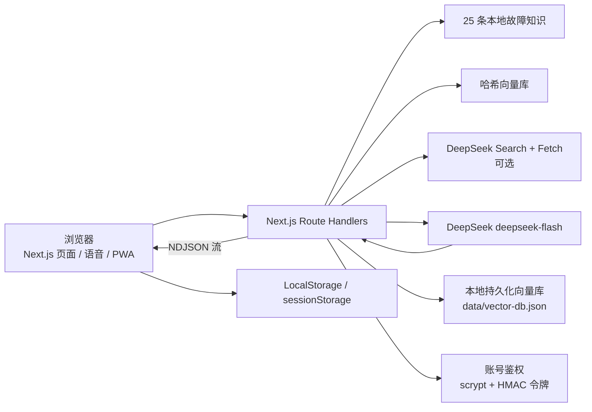

<!-- 用途：校园电脑管家赛事版项目说明、架构、运行测试、评分点与提交信息。 -->
# 校园电脑管家

> 面向高校宿舍场景的学生电脑 AI 诊断、知识检索与维修协同平台。

## 赛事信息

- 赛事：技筑视界·码绘交互——Web 前端开发创意技能大赛
- 作品名称：校园电脑管家
- 提交截止：2026-10-25 23:59
- 现场答辩：2026-10-28 19:30–22:00
- 团队信息：`信息工程学院 / 游手好闲队 / 队长：李永浩 / 成员：许志宽、刘育贤`

## 一句话定位

把学生的口语故障描述转化为有知识依据、多轮追问、可执行步骤和维修工单的完整闭环。

## 核心功能

- 设备体检：读取浏览器公开的 CPU、内存、网络和电池信息。
- 多轮 AI 问诊：结合最近对话判断信息是否充分，信息不足时继续追问。
- 本地 RAG：25 条六元组故障知识 + 关键词召回 + 哈希向量检索。
- 可选联网增强：DeepSeek Search + Fetch，默认关闭，设置 `DEEPSEEK_WEB_SEARCH=true` 开启。
- 角色化 AI：学生、维修员、管理员使用不同系统 Prompt。
- 诊断证据：展示本地知识库/联网来源、关键词、置信度和网页链接。
- 结构化结果：故障摘要、可能原因、排查步骤、紧急程度、建议、是否报修、追问问题。
- 语音问诊与播报：浏览器 SpeechRecognition / SpeechSynthesis，不支持时自动隐藏。
- 学习模式：把追问渲染成“步骤 1/N”，支持上一步、下一步和逐题回答。
- 错误码识别：识别 `0x0000007B`、`INACCESSIBLE_BOOT_DEVICE` 等代码并注入诊断上下文。
- 诊断报告：导出包含时间、角色、摘要、原因、步骤、来源与免责声明的 Markdown。
- 一键工单：把诊断标题、设备类型、描述和优先级预填到报修页。
- 工单闭环：提交、状态推进、维修记录、AI 维修建议、完成与 1–5 星评价。
- 账号登录鉴权：维修员/管理员需账号密码登录，凭证只在服务端比对（scrypt 加盐哈希 + HMAC 会话令牌），不存放在页面中。
- 维修员特供资料库：仅维修员登录后可用，内置本地持久化向量库（哈希嵌入 + 余弦检索），含维修图文资料与可播放的视频课件，支持检索与补充资料。
- 工单 AI 诊断：AI 诊断能力收敛到工单上，维修员/管理员在工单页面即可对具体工单发起 AI 辅助诊断。
- 维修员上传后台数据：维修员一键上传工单统计与明细，管理员在看板查看上传记录。
- 角色入口调整：知识图谱与独立 AI 诊断页仅对学生开放；维修员/管理员导航不含首页，点击「学生」自动回到首页。
- 管理端：状态分布、故障类型图、AI 运维洞察、评分汇总、CSV 导出。
- PWA：Manifest、安装图标、Service Worker、离线知识图谱与离线提示。
- 数字人「小管家」：SVG 吉祥物跟随 AI 诊断进度变化表情（待命 / 分析中 / 已定位 / 建议报修），气泡显示 AI 结论摘要，可一键朗读 AI 回答，支持点击互动。
- 校园就近派单：提交工单时按宿舍楼宇在 SVG 校园地图上自动推荐最近空闲维修员，并给出预计到场时长。

## 评分点对照

| 评分维度 | 权重 | 本项目做了什么 | 主要代码位置 |
| --- | ---: | --- | --- |
| AI 技术深度 | 35% | DeepSeek 多轮问诊、角色 Prompt、JSON 结构化输出、本地 RAG、可选 Search + Fetch、失败降级 | `src/app/api/diagnose/route.ts`、`src/lib/knowledge-base.ts`、`src/lib/rag-vector-store.ts`、`src/lib/deepseek-search.ts` |
| 创新性 | 25% | 从诊断直接生成工单、学习模式步骤卡、错误码上下文、证据链、AI 维修摘要、管理洞察、账号鉴权、本地向量资料库 | `src/app/diagnosis/page.tsx`、`src/lib/error-code.ts`、`src/app/api/repair-advice/route.ts`、`src/app/api/insight/route.ts`、`src/lib/local-vector-db.ts`、`src/lib/auth-store.ts` |
| 前端工程质量 | 10% | Next.js 15 + TypeScript + Tailwind、分层目录、类型检查、8 条核心测试、GitHub Actions CI、PWA | `src/lib`、`tests/core.test.ts`、`.github/workflows/ci.yml` |
| 实用性 | 10% | 面向宿舍报修，覆盖体检、问诊、报修、维修、评价和管理统计 | `src/app` 全部页面与 `src/lib/storage.ts` |
| 用户体验 | 10% | 响应式 UI、流式响应、离线提示、证据卡、语音、报告、操作示意图、14 秒演示视频 | `src/components`、`src/app/diagnosis/page.tsx` |
| 社会价值与商业潜力 | 10% | 降低误操作和沟通成本，可复制到其他院校，具备知识库运营与运维数据服务潜力 | 知识库、管理看板、本地部署方案 |

## 技术架构



## 技术栈

- Next.js 15 App Router
- React 19 + TypeScript
- Tailwind CSS 3
- OpenAI 兼容 SDK + DeepSeek `deepseek-flash`
- 自研字符 n-gram 哈希向量检索
- LocalStorage / sessionStorage
- Web Speech API、Canvas、MediaRecorder
- Service Worker + Web App Manifest

## 目录结构

```text
chat/
├── src/
│   ├── app/
│   │   ├── page.tsx
│   │   ├── checkup/page.tsx
│   │   ├── diagnosis/page.tsx
│   │   ├── graph/page.tsx
│   │   ├── tickets/page.tsx
│   │   ├── tickets/new/page.tsx
│   │   ├── technician/page.tsx
│   │   ├── technician/library/page.tsx
│   │   ├── admin/page.tsx
│   │   ├── login/page.tsx
│   │   ├── manifest.ts
│   │   └── api/
│   │       ├── diagnose/route.ts
│   │       ├── repair-advice/route.ts
│   │       ├── insight/route.ts
│   │       ├── auth/login/route.ts
│   │       ├── auth/session/route.ts
│   │       ├── technician/knowledge/route.ts
│   │       └── repair-reports/route.ts
│   ├── components/
│   └── lib/
│       ├── auth-store.ts            # 服务端账号与令牌（不随客户端打包）
│       ├── auth-context.tsx         # 登录态与页面守卫
│       ├── vector-core.ts           # 哈希向量嵌入与相似度
│       ├── local-vector-db.ts       # 本地持久化向量库
│       ├── technician-knowledge.ts  # 维修员特供资料种子数据
│       └── repair-reports.ts        # 维修员上传记录存储
├── knowledge-base/
│   ├── data/knowledge_base.json
│   └── docs/
├── public/
│   ├── sw.js
│   ├── offline.html
│   └── icons/
├── tests/core.test.ts
├── .github/workflows/ci.yml
├── docs/
│   ├── 技术文档.md
│   ├── 技术文档.pdf
│   ├── 演示视频脚本.md
│   └── 答辩Q&A.md
├── .env.example
├── package.json
└── README.md
```

## 环境变量

复制 `.env.example` 为 `.env.local`：

| 变量 | 必填 | 默认 | 说明 |
| --- | --- | --- | --- |
| `DEEPSEEK_API_KEY` | 是 | 无 | 服务端 DeepSeek API Key，不得提交到仓库 |
| `DEEPSEEK_BASE_URL` | 否 | `https://api.deepseek.com` | OpenAI 兼容 API 地址 |
| `DEEPSEEK_MODEL` | 否 | `deepseek-flash` | 维修建议和管理洞察使用；诊断接口使用 `deepseek-flash` |
| `DEEPSEEK_WEB_SEARCH` | 否 | `false` | 设为 `true` 开启 Search + Fetch 联网检索 |
| `AUTH_SECRET` | 否 | 自动生成并持久化到 `data/.auth-secret` | 登录令牌 HMAC 密钥；配置后重启不影响会话 |
| `AUTH_ADMIN_USERNAME` / `AUTH_ADMIN_PASSWORD` | 否 | `admin` / `admin123` | 管理员演示账号 |
| `AUTH_TECHNICIAN_USERNAME` / `AUTH_TECHNICIAN_PASSWORD` | 否 | `tech` / `tech123` | 维修员演示账号 |

## 演示账号

| 角色 | 账号 | 密码 | 说明 |
| --- | --- | --- | --- |
| 学生 | 无需登录 | — | 点击右上角「学生」自动回到首页 |
| 维修员 | `tech` | `tech123` | 工作台、特供资料库、上传后台数据 |
| 管理员 | `admin` | `admin123` | 管理看板、查看维修员上传数据 |

账号口令只在服务端校验（scrypt 加盐哈希 + 常量时间比较），登录成功后签发 HMAC
会话令牌（默认 8 小时）。生产部署请务必通过环境变量修改默认口令。

## 运行与构建

```bash
npm ci
npm run dev
```

生产构建与启动：

```bash
npm run build
npm start
```

质量检查：

```bash
npm run typecheck
npm test
node --check public/sw.js
```

当前 CI：`npm ci → npm run typecheck → npm test → npm run build`。

## PWA 与离线说明

- 生产环境自动注册 `public/sw.js`，开发环境不注册。
- 预缓存 `/`、`/graph`、`/diagnosis`、`/checkup`、Manifest、离线页和安装图标。
- 导航使用 network-first，静态资源使用 cache-first。
- `/api/` 不缓存，离线时返回可读 JSON 错误。
- 离线时可打开知识图谱，提示“25 条故障可离线查看”。
- AI 诊断和联网检索仍需要网络连接。

验证方法：

1. `npm run build && npm start`
2. 访问 `/graph` 并等待 Service Worker 激活
3. DevTools Network 切换 Offline
4. 刷新 `/graph`，页面应继续可用

## 在线演示

在线演示可使用项目根目录的 `启动校园电脑管家.bat` 本地启动；README 不写死临时隧道地址。

## 已知限制

- LocalStorage / sessionStorage 是演示级存储，不是生产数据库。
- 账号鉴权为演示级实现：口令哈希与令牌校验均在服务端完成，但账号来源是代码内置默认值（可用环境变量覆盖），生产应接入真实用户体系。
- 联网检索默认关闭，搜索结果质量和可用性依赖外部网络。
- RAG 向量库为进程内轻量索引，服务重启后重建；维修员特供资料库为本地持久化向量库（`data/vector-db.json`，已 gitignore，删除后自动用种子数据重建）。
- 视频课件为内置 SVG 动画演示，离线可播放；放入 `public/videos` 真实视频后可在资料中配置 `videoSrc` 切换。
- 语音、视频生成依赖浏览器能力，Chrome/Edge 支持最佳。
- 生成视频为 WebM，赛事提交仍需单独录制 5–8 分钟 MP4。

## 仓库与发布

- GitHub 公开仓库：https://github.com/rzdx-lyh/campus-computer-care
- Release v1.0.0：https://github.com/rzdx-lyh/campus-computer-care/releases/tag/v1.0.0
- 技术文档 PDF：`docs/技术文档.pdf`（20 页）
- 演示视频脚本 / 答辩 Q&A：`docs/`

提交前执行 Key 自查：

```bash
git grep -n -E "s[k]-[A-Za-z0-9_-]{20,}"
```

该命令应无输出。不要提交 `.env.local`。

## License

本项目代码采用 MIT License，见根目录 `LICENSE`。`knowledge-base/` 目录保留其原有 MIT License。


