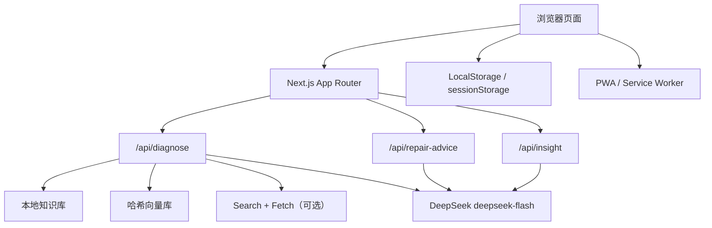
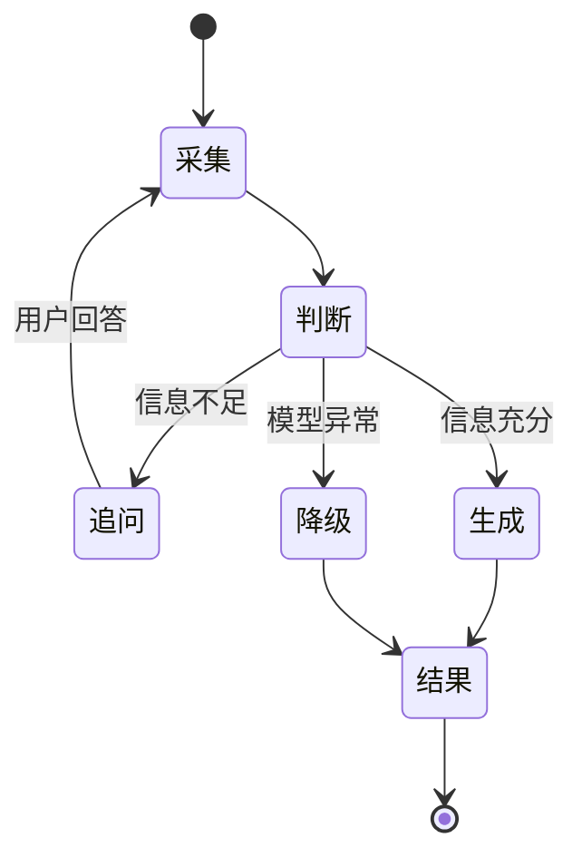
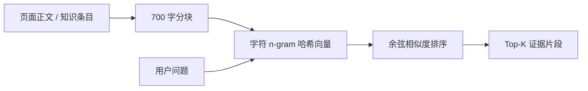

<!-- 用途：赛事技术文档正文，可直接排版为 20–25 页 PDF。 -->
# 校园电脑管家技术文档

- 文档版本：v1.0
- 日期：2026-10-20
- 赛事：技筑视界·码绘交互——Web 前端开发创意技能大赛
- 技术栈：Next.js 15、TypeScript、Tailwind CSS、DeepSeek

---

# 1. 项目概述

## 1.1 项目背景

高校宿舍中的电脑故障具有高频、分散、表达不专业和处理时间紧的特点。学生通常只能用“黑屏”“蓝屏”“很卡”“连不上网”等现象描述问题，难以提供电源状态、错误码、外接屏结果等关键条件。群聊、搜索引擎和短视频平台虽然能提供答案，但存在信息碎片化、版本过期、广告干扰和误操作风险。

学校维修渠道更偏向硬件维修和线下排队，对网络认证、驱动冲突、散热积灰等常见问题缺少第一时间的结构化问诊。学生需要重复描述问题，维修员也需要重新确认背景，整体沟通成本较高。

校园电脑管家面向这一真实场景，构建“设备体检 → 多轮 AI 问诊 → 本地知识检索 → 一键报修 → 维修建议 → 维修评价 → 管理洞察”的闭环。

## 1.2 项目目标

1. 让学生用自然语言完成故障描述，不要求掌握专业术语。
2. 通过多轮追问补齐关键条件，避免模型在信息不足时直接下结论。
3. 以本地 25 条故障知识为基础，提供可追溯的 RAG 诊断依据。
4. 输出结构化、可执行的排查步骤，并明确安全边界。
5. 将诊断结果直接转换为维修工单，减少重复填写。
6. 为维修员提供 AI 维修摘要，为管理员提供统计和运维洞察。
7. 在没有网络时仍可打开知识图谱和本地知识。

## 1.3 目标用户

- 学生：自助排查、语音问诊、报告导出、提交工单和评价。
- 维修员：接单、AI 维修建议、维修记录、完成工单。
- 管理员：状态统计、故障类型分析、AI 洞察和 CSV 导出。

## 1.4 当前边界

- 数据使用 LocalStorage / sessionStorage，定位为课程设计和赛事演示。
- 无登录与真实权限系统，角色切换只影响导航和 AI Prompt。
- 联网 Search + Fetch 默认关闭。
- RAG 向量库为进程内索引，服务重启后自动重建。
- 视频生成为浏览器 WebM，不替代赛事要求的 5–8 分钟 MP4。

---

# 2. 需求分析

## 2.1 学生需求

| 需求 | 解决方式 |
| --- | --- |
| 不知道如何描述故障 | 自然语言聊天、语音输入、快捷问题 |
| 信息不足时无法判断 | AI 返回追问问题，学习模式逐题引导 |
| 不信任 AI 结论 | 展示知识库/网页来源、置信度和匹配关键词 |
| 排查步骤不清晰 | 结构化原因、步骤、风险等级和安全提示 |
| 报修重复填写 | 诊断结果生成工单草稿并自动预填 |
| 维修后无法反馈 | 已完成工单支持 1–5 星与一句话评价 |

## 2.2 维修员需求

维修员需要快速理解故障历史，而不是只看一句“电脑坏了”。系统提供工单标题、描述、优先级、预约时间、维修记录和 AI 维修建议。AI 建议包含一句话判断、可能原因、建议备件或工具、预计工时、维修与验收步骤。

## 2.3 管理员需求

管理员需要从工单中看到趋势，而不是逐条阅读。系统提供总数、待接单、维修中、完成率、故障类型柱状图、最近工单、平均评分和 AI 运维洞察。

## 2.4 非功能需求

- 流式输出，避免长等待。
- 无 Key 或模型失败时不影响页面使用。
- 移动端布局可用。
- API Key 仅在服务端。
- 不鼓励学生自行拆机。
- 诊断依据可展示、可导出、可离线查看。

---

# 3. 系统架构

## 3.1 总体架构



## 3.2 分层说明

- 表现层：React Server/Client Components + Tailwind。
- API 层：三个 Node.js Route Handler。
- AI 编排层：角色 Prompt、对话历史、知识检索、JSON 解析和降级。
- 数据层：LocalStorage 工单、sessionStorage 诊断草稿。
- 离线层：Manifest、Service Worker、离线兜底页。
- 浏览器能力层：语音、报告、SVG、Canvas 视频。

## 3.3 目录分层

`src/app` 负责路由和页面；`src/components` 负责可复用 UI；`src/lib` 负责类型、存储、知识检索和浏览器能力；`knowledge-base` 保存结构化知识；`tests` 保存核心测试；`docs` 保存交付材料。

---

# 4. AI 技术方案

## 4.1 模型选型

项目选择 DeepSeek `deepseek-flash`，原因如下：

1. 与 OpenAI SDK 兼容，接入成本低。
2. 中文理解和生成能力适合校园问答。
3. 支持流式输出与 JSON Output。
4. 成本相对可控，便于比赛演示和后续部署。
5. 官方提供 Search + Fetch，可作为可选外部知识增强。

项目没有选择微调，主要原因是故障知识频繁更新、样本量有限，RAG 更容易维护和解释；微调成本高且不利于答辩时说明知识来源。

## 4.2 多轮问诊

系统要求模型输出“信息是否充分”和“追问问题”。前端保留最近 8 条对话，后端限制单条历史 2000 字符、当前描述 500 字符。Prompt 要求最多引导补充 2 轮，不重复询问已回答内容。



## 4.3 本地知识库

知识库包含 25 条六元组：

```json
{
  "故障类型": "蓝屏",
  "现象关键词": ["蓝屏", "重启"],
  "追问问题": ["能否看到错误码？"],
  "可能原因": ["驱动冲突"],
  "排查步骤": ["记录错误码"],
  "紧急程度": "高"
}
```

关键词检索对故障类型和现象关键词进行精确包含与字符重合度打分。为避免“电脑卡”误命中“电脑很烫”，当前只接受评分不低于 8 的高置信候选。

## 4.4 向量 RAG

`rag-vector-store.ts` 使用字符 unigram、bigram、trigram 特征，通过 FNV-1a 哈希映射到 384 维向量，并进行归一化和余弦相似度计算。网页内容按约 700 字切块、100 字重叠，适合中文长文本检索。



## 4.5 联网 Search + Fetch

设置 `DEEPSEEK_WEB_SEARCH=true` 后：

1. 调用 `/v1/tools/search` 搜索 6 条结果。
2. 过滤相关性低于 0.45、标题过短或无标题的页面。
3. 最多选择 2 条，调用 `/v1/tools/fetch` 获取 Markdown 正文。
4. 清洗正文并加入向量库。
5. 仅把网页向量片段注入 Prompt。

联网默认关闭，因为搜索结果相关性存在波动，而且 Search/Fetch 按成功请求计费。

## 4.6 角色 Prompt

- 学生：亲切、少术语、安全优先。
- 维修员：专业原因、备件、工时和验收标准。
- 管理员：影响范围、处理优先级、资源调度和预防建议。

## 4.7 结构化输出

模型只输出 JSON，后端同时保留中文字段和前端使用的英文字段。若返回 Markdown 围栏，会清理后重新解析。

## 4.8 降级策略

- 无 Key：返回 `error + result`，页面仍显示兜底结果。
- 非标准 JSON：记录原始文本，返回降级诊断。
- 流中断：保留已输出内容并追加兜底。
- 联网失败：继续使用本地知识。
- 兜底标记：`degraded=true`、`informationSufficient=false`、`needRepair=true`。

---

# 5. 核心功能实现

## 5.1 首页与设备体检

首页提供体检和 AI 诊断入口。体检页读取浏览器公开能力，并在不支持时显示“浏览器未开放”，不把浏览器限制等同为硬件故障。

## 5.2 诊断页

诊断页包含文字输入、语音识别、快捷问题、学习模式、错误码提示、流式消息、证据卡、追问、报告、朗读、视频和工单入口。

## 5.3 工单与评价

工单状态为 `pending → repairing → completed`。学生可提交宿舍、设备、描述、照片 Base64、预约时间。完成后可写入 1–5 星和一句话评价。

## 5.4 维修员与管理员

维修员可以接单、请求 AI 维修建议、填入维修记录并完成。管理员可查看统计、生成 AI 洞察和导出带 UTF-8 BOM 的 CSV。

## 5.5 知识图谱

`/graph` 使用纯 SVG 展示故障类型、知识条目、现象和原因。任意节点带 `q` 参数跳转诊断页，页面读取 URL 后预填输入框。

## 5.6 PWA 离线

Manifest 提供安装信息和 192/512 图标。Service Worker 预缓存首页、图谱、诊断、体检、Manifest、离线页和静态 JS/CSS。导航 network-first，静态资源 cache-first，API 不缓存。

---

# 6. 测试与质量

## 6.1 自动化测试

项目使用 Node Test Runner + tsx，共 8 条测试：

1. 键盘失灵正向召回。
2. 奖学金负样本和“电脑卡不命中风扇”。
3. 两个蓝屏错误码识别。
4. CSV 表头、转义和 BOM。
5. 报告摘要、来源和免责声明。
6. 诊断草稿优先级和长度。
7. 向量库同 ID 去重与空查询。
8. 知识库 25 条及六元组完整性。

## 6.2 CI

GitHub Actions 执行：

```text
npm ci
npm run typecheck
npm test
npm run build
```

## 6.3 手工验收

- Chrome/Edge 语音识别和播报。
- 诊断追问、错误码提示和报告下载。
- 工单草稿预填、维修建议、评价和 CSV。
- PWA 生产注册、Offline 刷新 `/graph`。
- 手机宽度布局和触控操作。

## 6.4 质量策略

- 所有 AI 结果带免责声明。
- API Key 不进入客户端。
- 服务端输入长度限制。
- 知识库召回设置最低阈值。
- 流式协议逐行 JSON，前端坏行跳过。
- LocalStorage 解析失败回退空数组。

---

# 7. 部署与运行

## 7.1 环境变量

```bash
DEEPSEEK_API_KEY=服务端密钥
DEEPSEEK_BASE_URL=https://api.deepseek.com
DEEPSEEK_MODEL=deepseek-flash
DEEPSEEK_WEB_SEARCH=false
```

## 7.2 本地运行

```bash
npm ci
npm run dev
```

生产：

```bash
npm run build
npm start
```

## 7.3 在线部署

可部署到 Vercel 或支持 Node.js 的平台。需要在平台环境变量中配置 API Key，不能写入源码。PWA 需要 HTTPS 或 localhost。

在线演示地址以 `docs/33-部署与演示说明.md` 为准，不在 README 写死临时隧道。

---

# 8. 创新点

1. **诊断到报修的连续体验**：AI 输出可直接生成工单草稿，避免重复录入。
2. **证据驱动诊断**：同时展示本地知识、联网来源、关键词和置信度。
3. **学生学习模式**：把追问转换成逐题步骤卡，降低认知负担。
4. **错误码上下文识别**：从知识库自动生成错误码映射，并附加到诊断 Prompt。
5. **角色化 AI**：同一个诊断能力面向学生、维修员和管理员调整输出视角。
6. **AI 维修闭环**：从学生诊断延伸到维修建议、维修记录和管理洞察。
7. **离线知识入口**：网络不可用时仍可查看 25 条故障知识。
8. **轻量 RAG 实现**：无外部向量数据库依赖，适合课程部署和现场演示。

---

# 9. 社会价值与规划

## 9.1 社会价值

- 降低学生因错误搜索导致的数据丢失和硬件误操作风险。
- 缩短常见故障的首次响应时间。
- 让维修员获得更完整的上下文。
- 让学校从零散报修数据中获得运维决策依据。
- 知识库可按学校网络认证、宿舍和报修流程本地化。

## 9.2 商业与推广潜力

可扩展为校园 IT 服务台 SaaS：学校购买部署与知识库维护服务，按校区或设备规模收费；也可与信息中心工单系统、资产管理、备件库存和设备保修数据对接。

## 9.3 后续规划

1. 登录、RBAC 和服务端数据库。
2. 知识库后台 CRUD、版本管理和审核流程。
3. 真实向量数据库与混合检索评估。
4. 图片/截图 OCR 和多模态诊断。
5. 工单通知、维修排班、备件库存和 SLA。
6. AI 质量评测集、成本监控和调用日志。
7. 正式 MP4 演示视频、公网部署和压力测试。

## 9.4 总结

校园电脑管家的核心不是单次调用大模型，而是把多轮问诊、知识检索、结构化输出、证据展示、工单闭环和离线能力组合成可解释、可降级、可演示的工程方案。当前版本适合赛事展示和课程验收，下一步应在鉴权、持久化、测试深度和运维能力上继续工程化。
