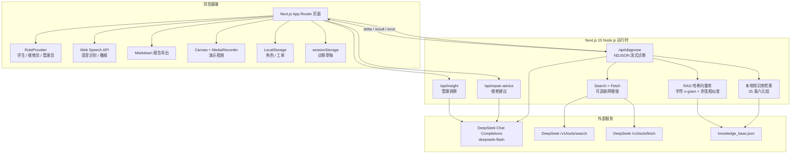
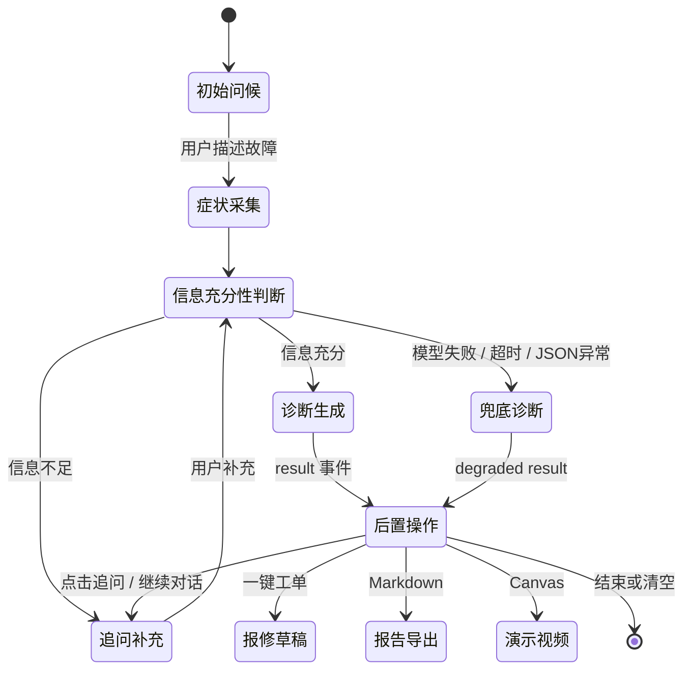
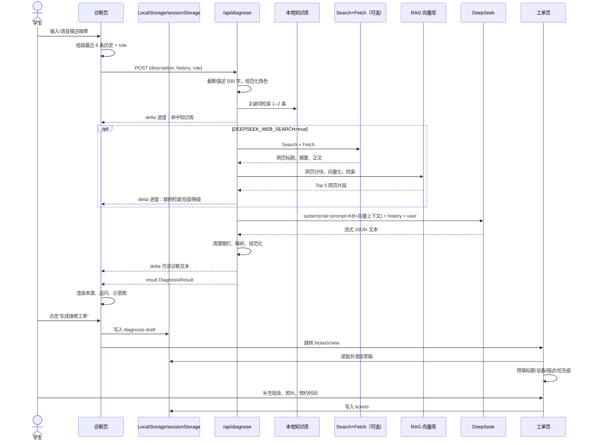
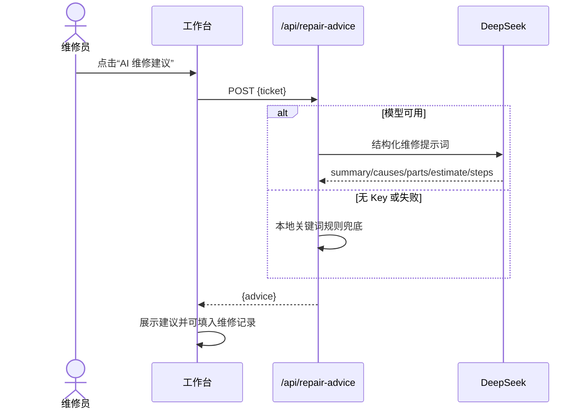

# 校园电脑管家 · 程序设计说明书 v1.0

- 文档版本：v1.0
- 编写日期：2026-10-20
- 项目根目录：`C:\Users\Administrator\Desktop\code\ai web\ai web\chat`
- 技术基线：Next.js 15 + TypeScript + Tailwind CSS + DeepSeek
- 文档性质：基于当前代码现状的设计说明，不包含未落地功能的虚假承诺

---

## 1. 项目概述

### 1.1 项目定位

“校园电脑管家”是面向高校宿舍场景的 AI 电脑故障诊断与报修协同系统。系统把设备体检、多轮 AI 问诊、故障知识库、联网检索、维修建议、工单流转和管理数据洞察整合在同一个 Web 应用中。

当前系统由三部分组成：

1. **学生自助诊断**：描述故障、回答 AI 追问、查看可能原因和排查步骤。
2. **校园维修协同**：生成工单、维修员接单、填写维修记录、标记完成。
3. **管理数据洞察**：查看工单状态、故障类型统计，并生成 AI 运维建议。

### 1.2 目标用户

| 用户 | 核心目标 |
| --- | --- |
| 学生 | 不懂专业术语也能描述问题；先安全地自助排查；确需维修时快速报修 |
| 维修员 | 快速理解故障背景；获取维修建议、备件和验收步骤；减少重复沟通 |
| 管理员 | 掌握工单总量与状态分布；识别高频故障；辅助人员与备件调度 |

### 1.3 真实痛点

- 学生只掌握“黑屏、蓝屏、连不上网”等现象，不知道如何补充关键条件。
- 群聊和搜索结果碎片化，可能包含过期、无关甚至有风险的方案。
- 学校报修渠道与自助排查割裂，故障信息需要重复填写。
- 维修员缺少统一的结构化工单背景与验收标准。
- 管理员只能看到零散工单，缺少高频故障和积压情况的即时洞察。

### 1.4 项目价值

- **降低首轮沟通成本**：AI 先完成问诊、信息补全和初步原因排序。
- **降低误操作风险**：系统提示先断电，不鼓励学生自行拆机。
- **形成可追溯的诊断依据**：结果卡展示本地知识库和可选联网来源。
- **打通诊断到报修**：诊断结果可转换为工单草稿，自动预填关键信息。
- **提升维修效率**：维修员可获得 AI 维修摘要、备件建议和验收步骤。
- **提供管理决策依据**：管理端能生成基于现有统计的 AI 洞察。

### 1.5 当前边界

- 数据主要存储在浏览器 LocalStorage / sessionStorage，没有服务端数据库。
- 角色切换是前端交互状态，不等同于真实登录鉴权和权限控制。
- 联网检索默认关闭，需要显式设置 `DEEPSEEK_WEB_SEARCH=true`。
- 演示视频由浏览器生成 WebM，不是服务端 MP4 渲染。
- 当前 RAG 向量库为进程内轻量索引，服务重启后重建。

---

## 2. 需求分析

### 2.1 学生角色

| 需求 | 当前实现 |
| --- | --- |
| 查看电脑基础状态 | `/checkup` 读取 `navigator.deviceMemory`、`hardwareConcurrency`、`connection`、`getBattery` |
| 用自然语言描述故障 | `/diagnosis` 聊天输入框，支持文字和浏览器语音识别 |
| 获得多轮追问 | 后端根据“信息是否充分”返回 1–3 个追问问题 |
| 理解诊断依据 | 结果卡展示知识库/联网来源、匹配关键词和置信度 |
| 获得安全排查步骤 | 结构化“可能原因”“排查步骤”“建议” |
| 听取诊断内容 | 使用 `SpeechSynthesis` 朗读摘要与排查步骤 |
| 保存诊断结果 | 导出 Markdown 诊断报告 |
| 快速报修 | 一键生成工单草稿并跳转 `/tickets/new` |
| 跟踪工单 | `/tickets` 查看状态、预约时间与维修记录 |

### 2.2 维修员角色

| 需求 | 当前实现 |
| --- | --- |
| 查看待接单队列 | `/technician` 按 pending 状态筛选 |
| 接单 | 将工单从 `pending` 改为 `repairing` |
| 获取 AI 维修建议 | 调用 `/api/repair-advice` 获取原因、备件、工时和验收步骤 |
| 填写维修记录 | 文本编辑并保存到 `repairNote` |
| 标记完成 | 将工单改为 `completed`，保留维修记录 |
| 查看全部工单 | `/tickets` 支持筛选、搜索和状态推进 |

### 2.3 管理员角色

| 需求 | 当前实现 |
| --- | --- |
| 查看工单总数 | `/admin` 统计全部工单 |
| 查看状态分布 | 环形图展示待接单、维修中、已完成 |
| 查看故障类型分布 | 简单柱状图，按标题/描述关键词分类 |
| 查看最近工单 | 最近 5 条工单表格 |
| 生成 AI 运营洞察 | 调用 `/api/insight`，输出 2–3 句中文结论与建议 |
| 查看全部工单 | `/tickets` 支持搜索和状态推进 |

### 2.4 非功能需求

- 响应式布局，支持手机、平板和桌面端。
- AI 回复采用流式展示，降低首字等待感。
- 无密钥、模型失败或 JSON 异常时必须有本地兜底。
- 所有 AI 结果必须明确标注“仅供参考”。
- 敏感密钥只存在于服务端环境变量。
- 诊断报告、视频、语音等浏览器能力不可用时必须降级或隐藏入口。
- 当前系统优先保证演示可用性，不将 LocalStorage 误称为生产级持久化。

---

## 3. 总体架构



### 3.1 架构说明

- **表现层**：Next.js App Router 页面组件和手写 Tailwind 组件。
- **API 层**：三个 `route.ts`，均强制 `runtime = "nodejs"`、`dynamic = "force-dynamic"`。
- **AI 编排层**：负责角色 prompt、历史对话、本地检索、可选网页检索、JSON 解析和失败降级。
- **知识层**：25 条本地故障知识 + 可选的联网网页片段 + 进程内哈希向量索引。
- **浏览器能力层**：语音、报告下载、SVG 示意图、Canvas 演示视频。
- **持久层**：角色、工单写入 LocalStorage；诊断到工单的草稿写入 sessionStorage。

---

## 4. 模块划分与目录结构

```text
chat/
├── src/
│   ├── app/
│   │   ├── page.tsx                    # 首页
│   │   ├── layout.tsx                  # 根布局 / 角色 Provider
│   │   ├── globals.css                 # 全局 Tailwind 与基础样式
│   │   ├── checkup/page.tsx            # 设备体检
│   │   ├── diagnosis/page.tsx          # AI 多轮问诊
│   │   ├── tickets/page.tsx            # 工单列表
│   │   ├── tickets/new/page.tsx        # 工单提交
│   │   ├── technician/page.tsx         # 维修员工作台
│   │   ├── admin/page.tsx              # 管理员看板
│   │   └── api/
│   │       ├── diagnose/route.ts       # 诊断流式 API
│   │       ├── repair-advice/route.ts  # 维修建议 API
│   │       └── insight/route.ts        # 管理洞察 API
│   ├── components/
│   │   ├── site-header.tsx             # 顶部导航与角色切换
│   │   ├── page-header.tsx             # 页面标题
│   │   ├── status-badge.tsx            # 工单状态/优先级
│   │   ├── stat-card.tsx               # 统计卡片
│   │   ├── icon.tsx                    # 手写 SVG 图标
│   │   ├── operation-diagram.tsx       # 按故障生成 SVG 操作示意
│   │   └── demo-video-recorder.tsx     # Canvas 演示视频
│   └── lib/
│       ├── types.ts                    # 共享类型
│       ├── storage.ts                  # 工单 LocalStorage
│       ├── mock-data.ts                # 演示工单
│       ├── role-context.tsx            # 角色状态
│       ├── knowledge-base.ts           # 本地知识库检索
│       ├── deepseek-search.ts          # Search + Fetch 封装
│       ├── rag-vector-store.ts         # 哈希向量库
│       ├── use-speech.ts               # 语音识别/播报
│       ├── diagnosis-draft.ts          # 诊断到工单草稿
│       └── report-export.ts            # Markdown 报告
├── knowledge-base/
│   ├── data/knowledge_base.json        # 25 条六元组知识
│   ├── docs/                           # 技术文档大纲与答辩稿
│   ├── README.md
│   └── LICENSE
├── docs/
│   ├── 进度.md
│   └── workbuddy-memory/               # 合并时的过程记录
├── public/                              # 当前静态资源目录（如有）
├── package.json
├── .env.example
└── README.md
```

### 4.1 模块职责

| 模块 | 职责 |
| --- | --- |
| `site-header.tsx` | 角色切换、按角色显示导航 |
| `diagnosis/page.tsx` | 多轮对话、流式解析、语音、证据卡、报告、视频、工单草稿 |
| `operation-diagram.tsx` | 根据故障文本生成电源/网络/散热/显示/系统/外设 SVG 示意图 |
| `demo-video-recorder.tsx` | Canvas 绘制 + MediaRecorder 生成约 14 秒 WebM |
| `knowledge-base.ts` | 关键词/字符重合度打分，返回 1–2 条本地知识 |
| `rag-vector-store.ts` | 384 维字符 n-gram 哈希向量、700 字分块、余弦检索 |
| `deepseek-search.ts` | 官方 Search + Fetch、相关性过滤、正文清洗 |
| `repair-advice/route.ts` | 维修原因、备件、工时、验收步骤及本地兜底 |
| `insight/route.ts` | 管理统计的自然语言洞察及本地模板 |
| `storage.ts` | 工单 CRUD、状态推进、ID 生成 |
| `report-export.ts` | Markdown 报告生成与浏览器下载 |

---

## 5. AI 设计

### 5.1 多轮问诊状态机

当前实现是“模型判断 + 前端对话状态”的软状态机。前端保留最近 8 条对话，后端将其中用户上下文纳入检索；服务端 prompt 要求最多引导补充 2 轮。



状态约束：

- 前端历史最多发送 8 条，单条内容截断到 2000 字符。
- 当前用户描述在后端截断到 500 字符。
- prompt 要求不重复询问已回答问题。
- `informationSufficient=false` 时前端显示追问按钮，点击后填入输入框而不是直接发送。
- 信息充分度不是独立数据库状态，而是本次 AI JSON 输出字段。

### 5.2 知识库与 RAG 检索

本地知识库 `knowledge-base/data/knowledge_base.json` 包含 25 条六元组：

```text
故障类型
现象关键词[]
追问问题[]
可能原因[]
排查步骤[]
紧急程度
```

检索分两层：

1. **关键词检索**：`knowledge-base.ts` 对故障类型、现象关键词做精确包含和字符重合度打分，最多返回 2 条。
2. **向量检索**：`rag-vector-store.ts` 将知识内容切成约 700 字、100 字重叠的知识块，使用字符 unigram、bigram、trigram 做 384 维哈希向量，再通过余弦相似度排序。

联网检索开启时：

- 调用 `POST /v1/tools/search`，搜索 `count=6`，开启 `need_content`。
- 只保留 `rerank_score >= 0.45`、标题长度不少于 4 的页面。
- 最多选 2 个候选，并调用 `POST /v1/tools/fetch` 抓取正文。
- 网页正文清洗并截断到 14000 字符。
- 将网页片段加入向量库，检索前 5 个网页片段注入 prompt。

当前联网检索默认关闭，原因是现网结果相关性不稳定；课堂演示可设置 `DEEPSEEK_WEB_SEARCH=true` 开启。

### 5.3 角色化 Prompt

`/api/diagnose` 接受可选 `role`，非法值回退为 `student`：

| 角色 | Prompt 目标 |
| --- | --- |
| `student` | 亲切、少术语、先保证安全，再给出可执行排查步骤 |
| `technician` | 专业判断、可能损坏部件、备件、工时、验收标准 |
| `admin` | 影响范围、处理优先级、资源调度、预防措施 |

最终 system content 的拼接顺序为：

```text
ROLE_CONTEXT[role]
+ SYSTEM_PROMPT
+ formatKnowledgeContext(本地知识)
+ 可选联网向量上下文
```

### 5.4 结构化 JSON 输出

模型被要求只输出一个 JSON 对象，包含：

```json
{
  "故障摘要": "string",
  "可能原因": ["string"],
  "排查步骤": ["string"],
  "紧急程度": "高 | 中 | 低",
  "建议": "string",
  "是否需要报修": true,
  "信息是否充分": true,
  "追问问题": ["string"]
}
```

后端通过 `normalizeDiagnosis` 同时保留中文字段，并映射为前端使用的 `DiagnosisResult`：

- `summary`
- `riskLevel`
- `likelyCauses`
- `suggestedActions`
- `needRepair`
- `informationSufficient`
- `followUpQuestions`
- `sources`
- `ragConfidence`
- `webSearchUsed`

### 5.5 失败降级

| 场景 | 降级行为 |
| --- | --- |
| 缺少 `DEEPSEEK_API_KEY` | 返回 `error` 事件 + 兜底 `result` 事件 |
| 模型请求失败 | 保留已输出内容，追加 `error` + 兜底结果 |
| 模型不是标准 JSON | 清理代码围栏后重试解析，仍失败则兜底 |
| 联网 Search/Fetch 失败 | 持续输出提示，继续使用本地知识库 |
| 前端收到坏 NDJSON 行 | 跳过该行，不中断整个流 |
| 兜底结果 | `degraded=true`、`informationSufficient=false`、`riskLevel=medium`、`needRepair=true` |

前端收到 `type:"error"` 会显示“AI 服务降级”横幅；兜底结果仍然提供可执行建议和报修入口。

### 5.6 其他 AI 能力

- **维修建议**：`/api/repair-advice`，输出 summary / causes / parts / estimate / steps；无 Key 或异常时使用本地规则。
- **管理洞察**：`/api/insight`，输入 total、completionRate、statusCounts、faultStats，输出一段中文结论与资源建议；失败时本地模板。
- **语音问诊**：浏览器 SpeechRecognition 将中文口述转文字。
- **语音播报**：浏览器 SpeechSynthesis 朗读摘要与前两条排查步骤。
- **操作示意图**：按关键词生成纯 SVG，不依赖外部图片服务。
- **演示视频**：Canvas 绘制 4 个场景，MediaRecorder 生成 WebM。

---

## 6. API 契约与 NDJSON 事件协议

### 6.1 `POST /api/diagnose`

**运行时约束**

```ts
export const runtime = "nodejs";
export const dynamic = "force-dynamic";
```

**请求体**

```ts
interface DiagnoseRequest {
  description: string;
  history?: Array<{
    role: "user" | "assistant";
    content: string;
  }>;
  role?: "student" | "technician" | "admin";
}
```

**响应头**

```text
Content-Type: text/plain; charset=utf-8
Cache-Control: no-cache, no-store, must-revalidate, no-transform
Pragma: no-cache
X-Accel-Buffering: no
```

**NDJSON 事件协议**

每一行必须是完整 JSON，前端按 `split("\n")` 解析：

```json
{"type":"delta","text":"已命中本地知识库 2 条，正在生成诊断…\n\n"}
{"type":"delta","text":"故障摘要：笔记本电脑风扇转速异常…"}
{"type":"result","result":{"summary":"...","riskLevel":"medium"}}
{"type":"error","message":"AI 服务降级，已使用本地兜底结果。"}
```

事件说明：

| 字段 | 含义 |
| --- | --- |
| `delta.text` | 可读业务文本，前端追加到当前 AI 对话气泡 |
| `result.result` | 最终 `DiagnosisResult`，前端渲染结构化诊断卡 |
| `error.message` | 降级/异常提示，前端显示横幅，但保留 result |

**正常流程**：首条进度 delta → 可选联网进度 delta → 可读诊断 delta → result。
**异常流程**：error → 可读兜底 delta → result。即使发生错误，也尽量发送 result。

### 6.2 `POST /api/repair-advice`

请求：

```ts
interface RepairAdviceRequest {
  ticket: {
    title: string;
    description: string;
    deviceType?: string;
    priority?: "low" | "medium" | "high";
    repairNote?: string;
  };
}
```

正常响应：

```ts
{
  advice: {
    summary: string;
    causes: string[];
    parts: string[];
    estimate: string;
    steps: string[];
    degraded?: boolean;
  };
}
```

无 Key 或模型异常时返回本地规则生成的 `advice`，并用 `degraded=true` 标记。缺少标题或描述返回 400。

### 6.3 `POST /api/insight`

请求：

```ts
interface InsightRequest {
  total?: number;
  completionRate?: number;
  statusCounts?: Array<{ label: string; count: number }>;
  faultStats?: Array<{ label: string; count: number }>;
}
```

响应：

```ts
{
  content: string;
  degraded?: boolean;
}
```

无 Key 或异常时返回本地模板并设置 `degraded=true`。

### 6.4 API 共性

- 三个 API 均禁用静态缓存。
- 服务端密钥从 `process.env.DEEPSEEK_API_KEY` 读取。
- `/api/diagnose` 固定使用 `deepseek-flash`；维修建议与管理洞察读取 `DEEPSEEK_MODEL`，默认 `deepseek-flash`。
- 当前没有登录鉴权、限流或服务端审计日志。

---

## 7. 数据模型

### 7.1 Ticket

```ts
export type TicketStatus = "pending" | "repairing" | "completed";
export type TicketPriority = "low" | "medium" | "high";

export interface Ticket {
  id: string;
  title: string;
  description: string;
  deviceType: string;
  dorm: string;
  photo: string;       // Base64 Data URL，可为空
  status: TicketStatus;
  priority: TicketPriority;
  createdAt: string;   // ISO 时间
  repairNote: string;
  appointment?: string;
}
```

### 7.2 DiagnosisResult

```ts
export type DiagnosisSourceKind = "knowledge_base" | "web";

export interface DiagnosisSource {
  id: string;
  faultType: string;
  matchedKeywords: string[];
  confidence: number;
  score: number;
  kind?: DiagnosisSourceKind;
  title?: string;
  url?: string;
  siteName?: string;
  snippet?: string;
  publishedAt?: string;
}

export interface DiagnosisResult {
  summary: string;
  riskLevel: "low" | "medium" | "high";
  likelyCauses: string[];
  suggestedActions: string[];
  needRepair: boolean;
  informationSufficient?: boolean;
  followUpQuestions?: string[];
  sources?: DiagnosisSource[];
  ragConfidence?: number;
  webSearchUsed?: boolean;
  degraded?: boolean;
}
```

### 7.3 RepairAdvice

```ts
export interface RepairAdvice {
  summary: string;
  causes: string[];
  parts: string[];
  estimate: string;
  steps: string[];
  degraded?: boolean;
}
```

### 7.4 NDJSON 事件

```ts
export interface DiagnosisStreamEvent {
  type: "delta" | "result" | "error";
  text?: string;
  result?: DiagnosisResult;
  message?: string;
}
```

### 7.5 存储键

| 键 | 存储位置 | 用途 |
| --- | --- | --- |
| `campus-computer-care:role` | LocalStorage | 当前角色 |
| `campus-computer-care:tickets` | LocalStorage | 工单数组 |
| `campus-computer-care:diagnosis-draft` | sessionStorage | 诊断到工单的草稿 |

当前诊断草稿在工单页读取后立即清除；尚未增加 30 分钟 TTL 和“提交成功后清除”的补偿机制。

---

## 8. 页面与交互清单

| 页面 | 路由 | 角色 | 主要交互 |
| --- | --- | --- | --- |
| 首页 | `/` | 全部 | 欢迎语、角色提示、电脑体检/AI 诊断入口、服务流程 |
| 设备体检 | `/checkup` | 学生 | 读取浏览器设备信息、重新检测、隐私说明 |
| AI 诊断 | `/diagnosis` | 学生/维修员/管理员 | 多轮问诊、语音输入、流式回复、RAG 来源、追问、朗读、报告、视频、工单草稿 |
| 工单提交 | `/tickets/new` | 学生 | 填写宿舍/设备/故障、照片 Base64、预约时间、读取诊断草稿 |
| 工单列表 | `/tickets` | 学生/维修员/管理员 | 状态筛选、搜索、维修员/管理员推进状态 |
| 维修员工作台 | `/technician` | 维修员 | 待接单、接单、AI 维修建议、写入维修记录、完成工单 |
| 管理员看板 | `/admin` | 管理员 | 总数/状态/完成率、环形图、故障柱状图、最近工单、AI 洞察 |

### 8.1 全局角色切换

- 顶部下拉框支持学生、维修员、管理员。
- 角色写入 LocalStorage。
- 导航项随角色变化：学生看到体检和报修；维修员看到工作台；管理员看到看板。
- 角色只用于前端导航和 AI prompt，不构成安全权限。

### 8.2 诊断结果卡交互

1. 展示信息充分度、风险等级。
2. 展示本地/联网来源数量、类型、关键词和置信度。
3. 展示可能原因和建议操作。
4. 信息不足时展示追问按钮。
5. 生成 SVG 操作示意图。
6. 生成 WebM 演示视频。
7. 导出 Markdown 诊断报告。
8. 朗读诊断摘要。
9. 一键生成维修工单草稿。

### 8.3 工单状态流转

```text
pending（待接单） → repairing（维修中） → completed（已完成）
```

- 学生只能查看。
- 维修员和管理员可通过列表或工作台推进状态。
- 完成工单时写入维修记录或默认验收说明。

---

## 9. 关键流程时序

### 9.1 一次完整诊断与一键工单



### 9.2 维修员建议流程



---

## 10. 异常、安全与隐私

### 10.1 异常处理

| 异常 | 处理 |
| --- | --- |
| API Key 缺失 | `/api/diagnose` 返回降级事件；维修建议/洞察返回本地结果 |
| DeepSeek 超时 | 捕获异常，返回兜底结果 |
| 模型输出 Markdown 围栏 | 清理 ````json` / ```` 标记后解析 |
| 模型输出非 JSON | 发送 `error` 事件，提供兜底诊断 |
| 浏览器语音不支持 | 隐藏麦克风入口 |
| 语音权限拒绝 | 显示错误并允许继续文字输入 |
| MediaRecorder 不支持 | 提示使用 Chrome/Edge |
| Fetch 页面失败 | 使用 Search 返回的摘要/正文继续 |
| LocalStorage JSON 损坏 | `getStoredTickets` 返回空数组，避免页面崩溃 |

### 10.2 安全设计

- 系统提示词要求涉及拆机、进液、焦糊味、冒烟时先断电并送修。
- 不鼓励学生自行拆机。
- 模型输出只用于辅助判断，结果卡显示免责声明。
- DeepSeek `thinking` 使用 disabled，避免无关思考内容进入输出。
- 联网页面按相关性和标题质量过滤，降低无关内容注入风险。
- 当前仍然存在网页 prompt injection、恶意页面内容等风险，因为网页正文未做来源级隔离。

### 10.3 隐私设计

- API Key 只在服务端读取，不进入浏览器代码。
- 设备体检只读取浏览器公开指标，不上传。
- 照片以 Base64 存储在 LocalStorage，不会自动上传。
- 工单和诊断草稿只在本地浏览器保存。
- 联网检索默认关闭；开启后，用户故障描述会发送到 DeepSeek Search。
- 当前没有账号、服务端数据库、审计日志和数据删除接口。

### 10.4 当前安全缺口

- 角色切换是客户端自选，API 不校验真实身份。
- 三个 AI API 没有登录、限流、额度控制和滥用防护。
- LocalStorage 可被同源脚本读取，照片 Base64 可能造成容量压力。
- Web 检索内容可能包含广告、过期信息或提示词注入。
- 诊断草稿读取后立即删除，异常中断时可能丢失草稿。

---

## 11. 测试计划与验收标准

### 11.1 测试层次

| 层次 | 测试内容 |
| --- | --- |
| 单元测试 | 知识库检索、向量 cosine、JSON 围栏清理、角色规范化、维修建议兜底 |
| API 测试 | `/api/diagnose` 事件顺序、400/降级/无 Key、`/api/repair-advice`、`/api/insight` |
| 浏览器测试 | 文字/语音输入、追问、报告下载、视频生成、工单预填 |
| 兼容性测试 | Chrome、Edge、移动端布局、SpeechRecognition/MediaRecorder 不支持降级 |
| AI 质量测试 | 25 条知识正样本、负样本、模糊描述、蓝屏/风扇/网络等典型问题 |
| 性能测试 | 首条 delta 时间、完整诊断耗时、联网关闭/开启对比 |

### 11.2 核心测试用例

1. 输入“电脑黑屏”，AI 返回追问问题，`informationSufficient=false`。
2. 补充“电源灯亮、外接屏无画面、风扇在转”，结果切为 `informationSufficient=true`。
3. 输入风扇故障，RAG 来源包含“风扇噪音”，结果卡显示来源。
4. 无 `DEEPSEEK_API_KEY` 时接口仍返回可解析的 `error + result`。
5. 模型返回 ````json` 包裹内容时仍能解析最终 JSON。
6. 角色为 technician 时，诊断结果偏向维修步骤、备件和验收。
7. 点击报告导出，生成包含时间、角色、摘要、来源、免责声明的 Markdown。
8. 浏览器不支持语音时，麦克风入口隐藏。
9. 点击“用诊断结果创建维修工单”，标题/设备/描述/优先级自动预填。
10. 维修员请求 AI 建议，生成的原因/备件/工时/步骤可写入维修记录。
11. 管理员生成 AI 洞察，返回 2–3 句且不编造统计外数字。
12. 开启联网检索时，结果包含 `kind="web"` 来源和可点击 URL。

### 11.3 验收标准

| 项目 | 验收条件 |
| --- | --- |
| 构建 | `npm run build` 通过 |
| 流式诊断 | `/api/diagnose` 返回 200，至少包含 delta 和 result |
| 兜底 | 无 Key/模型异常不导致页面卡死，显示降级提示 |
| 角色 | student/technician/admin 三种 prompt 均有差异 |
| 知识库 | 25 条 JSON 可加载，命中时不崩溃 |
| 工单 | 新建、筛选、接单、维修中、完成均可操作 |
| 安全 | 不暴露 API Key；不鼓励学生自行拆机 |
| 响应式 | 390px 手机宽度无横向溢出 |
| 语音 | Chrome/Edge 支持时可输入，不支持时隐藏 |
| 视频 | 点击生成后能播放/下载 WebM；不支持时提示 |
| 报告 | 能下载 UTF-8 Markdown |
| 文档 | README、设计说明书、环境变量模板齐全 |

---

## 12. 10-20 ~ 10-25 五天实施排期

> 按 5 个执行阶段安排，10 月 25 日为最终提交日。比赛提交截止时间以章程为准：2026-10-25 23:59。

| 时间 | 工作 | 交付物 | 验收 |
| --- | --- | --- | --- |
| 10/20 | 冻结代码基线，初始化 Git，建立 Public 仓库，整理 `.env.example` 和 README | Git 提交历史、仓库地址、环境说明 | 他人可按 README 启动 |
| 10/21 | 补测试与 CI：单元测试、API 冒烟、角色/知识库/兜底用例 | `npm test`、CI 配置、测试记录 | 核心测试通过 |
| 10/22 | 完成技术文档 PDF：概述、需求、架构、AI、API、数据、测试、部署 | 《程序设计说明书》PDF，≤30 页 | 文档与代码一致 |
| 10/23 | 编写 5–8 分钟演示视频脚本，录制诊断、追问、RAG、报修、维修员、管理端 | 1080p MP4 + 字幕 | 演示链路完整 |
| 10/24 | 部署在线演示，准备测试账号/无账号说明，处理浏览器兼容问题 | 公网地址、部署说明 | 评委可直接访问 |
| 10/25 | 全量回归、材料命名与压缩、答辩演练 | 参赛压缩包、答辩稿 | 23:59 前提交成功 |

### 12.1 每日检查点

- **10/20 结束**：能 clone、install、build、dev。
- **10/21 结束**：至少覆盖知识库检索、诊断降级、工单草稿、维修建议四类测试。
- **10/22 结束**：PDF 可阅读，Mermaid 图能正常渲染。
- **10/23 结束**：视频能完整讲清“为什么做、怎么做、AI 在哪里、价值是什么”。
- **10/24 结束**：公网环境的 API Key 不暴露，联网开关状态明确。
- **10/25 结束**：压缩包、视频、PDF、仓库链接全部可访问。

### 12.2 答辩讲解顺序建议

1. 校园报修痛点与目标用户。
2. 设备体检 → 多轮问诊 → RAG 证据 → 一键工单完整演示。
3. 说明角色化 prompt 和本地兜底。
4. 说明 RAG 向量库和可选的 Search + Fetch。
5. 展示维修员 AI 建议和管理员 AI 洞察。
6. 说明当前边界、隐私设计和下一步工程化。

---

## 3 个最该补的代码缺口

1. **服务端身份鉴权与数据持久化**：当前角色由前端下拉框决定，工单保存在 LocalStorage，API 没有登录校验和审计。上线前应将角色、工单、维修记录迁移到服务端数据库，并以服务端会话或 JWT 校验学生/维修员/管理员权限。
2. **API 成本保护与 RAG 可观测性**：`/api/diagnose`、`/api/repair-advice`、`/api/insight` 尚未做登录限流、单用户额度、Search/Fetch 缓存和向量索引持久化；开启联网后每次诊断可能产生多个外部请求，需要缓存、超时、重试上限和调用统计。
3. **自动化测试与浏览器 E2E 覆盖**：当前主要依赖人工和构建验证，缺少 `node:test`/Vitest 单元测试、API 契约测试和 Playwright E2E；语音、报告下载、WebM 生成、角色切换和诊断草稿预填需要在 CI 或发布前形成可重复的回归测试。
